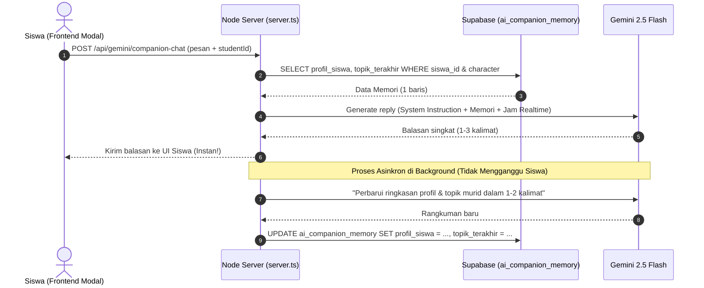

# Rencana Arsitektur & Desain: AI Companion Realistis & Sistem Memori Pintar

Dokumen ini adalah cetak biru teknis (*technical blueprint*) untuk mentransformasi Teman Belajar AI Ruang Spendaraja (**@aurora** & **@arunika**) menjadi karakter murid nyata SMP Negeri 2 Singaraja dengan gaya percakapan singkat, jadwal realistis anak sekolah, dan sistem ingatan jangka panjang (*Long-Term Memory*) berbasis **1 Baris per Siswa**.

---

## 1. Visi & Filosofi Karakter Murid Nyata

Chatbot standar AI biasanya terasa kaku, formal, siap sedia 24 jam tanpa lelah, dan selalu membalas dengan paragraf panjang ala buku teks. Visi dari pembaruan ini adalah menghadirkan **Teman Sebaya (*Peer Tutor*) Asli**:

```text
               Chatbot Biasa (Kuno)         vs       AI Murid Spendaraja (Baru)
┌────────────────────────────────────────┐       ┌────────────────────────────────────────┐
│ • Jawaban panjang lebar bertele-tele   │       │ • Jawaban singkat (1-3 kalimat WhatsApp)│
│ • Bahasa baku formal kaku              │       │ • Santai, hangat, gaul sopan anak SMP  │
│ • Selalu online 24/7 tanpa henti       │       │ • Punya jam sekolah, makan, tidur      │
│ • Tidak bisa menolak                   │       │ • Bisa menolak halus kalau lagi sibuk  │
│ • Amnesia (lupa obrolan kemarin)       │       │ • Ingat nama, hobi, & progres tugasmu  │
└────────────────────────────────────────┘       └────────────────────────────────────────┘
```

---

## 2. Karakteristik & Persona Murid

### A. Aurora (`@aurora`)
* **Identitas**: Murid perempuan Kelas 7 SMPN 2 Singaraja.
* **Persona**: Ramah, hangat, teliti, rajin, dan penyemangat.
* **Gaya Chat**: Kalimat pendek, santun, akrab, menggunakan emoji 🌸, ✨, 😊, 📚.
* **Contoh Chat**:
  > *"Pencet `Ctrl + E` aja! Judulnya jangan lupa digedein ke 20pt yaa biar rapi 🌸"*

### B. Arunika (`@arunika`)
* **Identitas**: Murid laki-laki Kelas 7 SMPN 2 Singaraja.
* **Persona**: Santai, gaul, to-the-point, jago logika komputer, dan suka analogi game.
* **Gaya Chat**: Singkat, cepat, asik, menggunakan emoji ⚡, 🚀, 💻, 😎.
* **Contoh Chat**:
  > *"Shortcut-nya `Ctrl + E` bro. Gas cobain, ga perlu ribet ngeklik menu lagi ⚡"*

---

## 3. Simulasi Jam & Jadwal Kehidupan Nyata (WITA)

Karakter AI merespons berdasarkan waktu nyata lokal Singaraja (WITA / UTC+8):

| Rentang Jam (WITA) | Status Karakter | Sikap & Reaksi AI |
|---|---|---|
| **07.00 - 12.30** | 🏫 *Jam Pelajaran Sekolah* | Balas kilat / menolak halus: *"Bntr ya, lagi ada guru di depan kelas nih 🤫"* atau *"Nanti pas istirahat aku cek ya!"* |
| **12.30 - 13.30** | 🥪 *Jam Istirahat / Pulang* | Santai & ramah: *"Lagi di kantin nih, knp tuh tugasnya?"* |
| **13.30 - 15.30** | 🚲 *Perjalanan / Ekskul TIK* | Kadang sibuk: *"Otw pulang nih, panas bgt Singaraja siang ini haha. Ntar sorean yaa!"* |
| **16.00 - 20.30** | 💡 *Jam Belajar & Ngerjain PR* | **Aktif Penuh & Fokus**: Sangat responsif membantu materi dan tugas. |
| **21.30 - 05.30** | 😴 *Jam Tidur / Istirahat* | Menolak ramah: *"Waduh udah malem nih, besok upacara pagi. Aku tidur duluan ya, besok kita lanjut lagi! 😴"* |

### Fitur "Lagi Mengerjakan Hal Lain" (10-15% Probability di Jam Santai)
* Aurora: *"Eh bentar ya, aku lagi nyalin catatan IPA yang ketinggalan. 5 menit lagi colek aku lagi yaa 🌸"*
* Arunika: *"Wait bro, lagi push rank / lagi beresin kuis sendiri bentar. Nanti tak bales lagi yaa ⚡"*

---

## 4. Arsitektur Memori Supabase: 1 Baris per Siswa (*Rolling Summary*)

Alih-alih menyimpan ribuan baris log chat yang membuat database membengkak dan token boros, sistem menggunakan **1 Baris Memori Dinamis per Siswa**:

### A. Skema Tabel Database: `ai_companion_memory`

```sql
-- Tabel Memori Teman Belajar AI Spendaraja
CREATE TABLE IF NOT EXISTS public.ai_companion_memory (
    id UUID PRIMARY KEY DEFAULT gen_random_uuid(),
    siswa_id INTEGER NOT NULL REFERENCES public.master_siswa(id) ON DELETE CASCADE,
    character TEXT NOT NULL DEFAULT 'aurora', -- 'aurora' atau 'arunika'
    
    -- Kolom 1: Kesimpulan Karakter & Kepribadian Siswa (Maks 1-2 Paragraf Ringkas)
    profil_siswa TEXT DEFAULT 'Murid baru, gaya bicara santai.',
    
    -- Kolom 2: Kesimpulan Topik Terakhir yang Sedang Dibahas
    topik_terakhir TEXT DEFAULT 'Baru menyapa dan berkenalan.',
    
    -- Kolom 3: Status Terakhir / Mood
    mood_siswa TEXT DEFAULT 'santai',
    
    -- Metadata
    total_obrolan INTEGER DEFAULT 0,
    created_at TIMESTAMPTZ DEFAULT NOW(),
    updated_at TIMESTAMPTZ DEFAULT NOW(),
    
    -- Constraint Unik: 1 Siswa hanya punya 1 catatan untuk Aurora dan 1 untuk Arunika
    CONSTRAINT unique_siswa_companion_memory UNIQUE (siswa_id, character)
);

-- Indeks Pencarian Cepat
CREATE INDEX IF NOT EXISTS idx_ai_companion_memory_lookup 
ON public.ai_companion_memory (siswa_id, character);
```

### B. Diagram Alur Kerja Otomatis (*Rolling Memory Cycle*)



---

## 5. Konfigurasi Model AI & Manajemen Kunci API

### A. Dukungan Model
* **Model Utama**: `gemini-2.5-flash` (Respon ultra-cepat < 1 detik, sangat hemat token, multimodal).
* **Model Penalaran Tinggi (Opsional)**: `gemini-2.5-pro` (Untuk analisa logika tingkat lanjut).

### B. Konfigurasi Lingkungan (`.env`)
```env
# API Key Gemini
GEMINI_API_KEY=AIzaSy...

# Konfigurasi Model Fleksibel (Bisa diganti kapan saja tanpa ubah kode)
GEMINI_COMPANION_MODEL=gemini-2.5-flash
```

---

## 6. Rencana Langkah Implementasi (Roadmap Eksekusi)

1. **Langkah 1: Pembuatan Tabel di Supabase** ✅ *(Selesai)*
   * Tabel `ai_companion_memory` & `ai_companion_messages` telah dibuat di Supabase tanpa mengganggu tabel lain.
   * Relasi `siswa_id` terikat ke `master_siswa(id)` dengan composite unique `(siswa_id, character)`.
   * Trigger timestamp otomatis aktif.

2. **Langkah 2: Pembaruan Backend ([`server.ts`](file:///c:/Users/dexdi/.antigravity-ide/ruang-spendaraja/server.ts))** ✅ *(Selesai)*
   * Endpoint `POST /api/gemini/companion-chat` membaca memori 1 baris per siswa sebelum memanggil Gemini.
   * Model dikonfigurasi via `process.env.GEMINI_COMPANION_MODEL || 'gemini-2.5-flash'`.
   * Jam lokal WITA diinjeksikan secara real-time untuk memicu kepribadian murid asli (status badge jam sekolah, jam pulang, jam santai, dan jam tidur).
   * Background task asinkron: menyimpan pesan ke `ai_companion_messages`, auto-summarize memori via Gemini Flash, mengupdate `ai_companion_memory`, dan auto-retention (memangkas chat lebih dari 20 pesan).
   * Endpoint `GET /api/gemini/companion-history` menyajikan riwayat obrolan dan ringkasan ingatan siswa.

3. **Langkah 3: Pembaruan Frontend ([`AiCompanionModal.jsx`](file:///c:/Users/dexdi/.antigravity-ide/ruang-spendaraja/src/components/RuangBelajar/AiCompanion/AiCompanionModal.jsx))** ✅ *(Selesai)*
   * Menerima `studentId` dari `RuangBelajar.jsx` (`student?.id`).
   * Mengambil riwayat pesan dan ingatan siswa saat modal atau karakter dibuka.
   * Badge status murid ditampilkan di header (🟢 Online, 🟡 Lagi di kelas, 🚲 Otw pulang, 😴 Jam tidur).
   * Chip ingatan kontekstual (`💭 Ingatan [Karakter]: "..."`) ditampilkan di atas feed percakapan.

4. **Langkah 4: Sinkronisasi & Verifikasi** ✅ *(Selesai)*
   * Dokumentasi [`AGENTS.md`](file:///c:/Users/dexdi/.antigravity-ide/ruang-spendaraja/AGENTS.md) dan [`docs/RUANG_BELAJAR.md`](file:///c:/Users/dexdi/.antigravity-ide/ruang-spendaraja/docs/RUANG_BELAJAR.md) disinkronkan.
   * Build produksi `npm run build` sukses 100% tanpa error.
