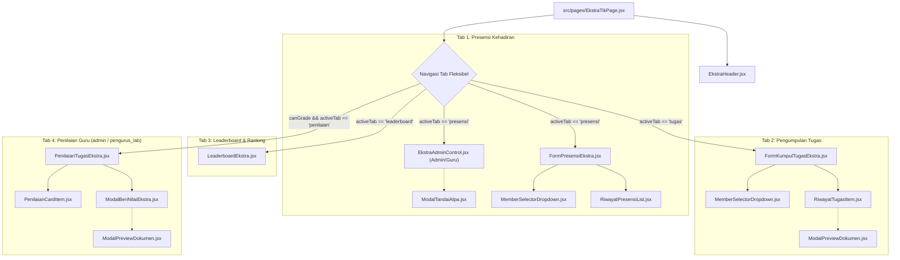

# Dokumentasi Arsitektur & Komponen: Ekstrakurikuler TIK (`src/components/EkstraTik`)

Dokumen ini menyajikan referensi komprehensif seluruh komponen React yang berada di dalam direktori `src/components/EkstraTik/` pada platform **Ruang Spendaraja (SMP Negeri 2 Singaraja)**. Modul ini melayani operasional presensi digital mingguan (setiap hari Jumat), pengumpulan tugas proyek teknologi bagi 43 anggota terpilih, evaluasi & penilaian guru, serta klasemen leaderboard siswa.

---

## 1. Peta File & Struktur Direktori

```text
src/components/EkstraTik/
├── EkstraHeader.jsx                  # Banner portal, status absensi live & kartu profil pengguna (anti-overlap navbar)
├── EkstraAdminControl.jsx            # Panel saklar kontrol sesi absen, ekspor CSV presensi & trigger alpa
├── FormPresensiEkstra.jsx            # Formulir pencatatan presensi siswa (Hadir) & guru (Izin/Sakit)
├── MemberSelectorDropdown.jsx        # Dropdown pencarian instan 43 anggota resmi Ekstra TIK
├── ModalTandaiAlpa.jsx               # Modal konfirmasi & eksekusi penandaan Alpa siswa belum absen
├── RiwayatPresensiList.jsx           # Log riwayat kehadiran gaya WhatsApp 1 kolom terbungkus per hari
├── FormKumpulTugasEkstra.jsx         # Formulir unggah tugas ke Cloudinary, panel rekap & auto-lock tugas dinilai
├── RiwayatTugasItem.jsx              # Kartu tugas dengan skor dinilai, proteksi unduh milik sendiri & visual badge
├── LeaderboardEkstra.jsx             # Podium 3 Besar & Papan Klasemen Juara XP Ekstra TIK
├── ModalPreviewDokumen.jsx           # Modal pratinjau dokumen multi-engine (Office Online & Google Docs)
├── ModalPanduanAppsScript.jsx        # Modal panduan & template kode integrasi Google Apps Script
│
└── PenilaianGuru/                    # Sub-modul Penilaian Tugas (Role: admin & role_2: pengurus_lab)
    ├── PenilaianTugasEkstra.jsx      # Kontainer utama evaluasi tugas, filter kelas/tugas, toggle Card & Table
    ├── ModalBeriNilaiEkstra.jsx      # Modal popup input nilai (0-100), quick preset nilai & feedback evaluasi
    └── PenilaianCardItem.jsx         # Kartu pengumpulan responsif mobile-friendly dengan tombol penilaian cepat
```

---

## 2. Diagram Arsitektur & Alur Data



---

## 3. Matriks Hak Akses Pengguna (Role-Based Access Control / RBAC)

Modul ini mengimplementasikan pemisahan hak akses ketat antara **Siswa**, **Pengurus Lab**, dan **Guru / Admin**:

| Fitur / Aksi | Siswa Terdaftar (43 Anggota) | Siswa Luar Anggota | Pengurus Lab (`role_2 = 'pengurus_lab'`) | Guru / Admin |
|---|:---:|:---:|:---:|:---:|
| **Melihat Beranda & Log Presensi** | ✅ Ya | ✅ Ya (Read-only) | ✅ Ya | ✅ Ya |
| **Mengisi Presensi Mandiri** | ✅ Ya (Hanya "Hadir", hari H) | ❌ Ditolak | ✅ Ya | ✅ Ya |
| **Mencatat Status Izin / Sakit** | ❌ Dilarang | ❌ Dilarang | ✅ Ya | ✅ Ya |
| **Buka / Tutup Sesi Absensi** | ❌ Dilarang | ❌ Dilarang | ❌ Dilarang | ✅ Ya (`game_controls`) |
| **Tandai Alpa Massal** | ❌ Dilarang | ❌ Dilarang | ❌ Dilarang | ✅ Ya (`ModalTandaiAlpa`) |
| **Unduh Rekap Presensi (.CSV)** | ❌ Dilarang | ❌ Dilarang | ❌ Dilarang | ✅ Ya |
| **Mengumpulkan Tugas Sendiri** | ✅ Ya (Jika belum dinilai) | ❌ Ditolak | ✅ Ya | ✅ Ya |
| **Mengunggah Ulang Tugas yang Sudah Dinilai** | ❌ **Dilarang (Auto-Locked)** | - | - | - |
| **Pratinjau Tugas Siswa Lain** | ✅ Ya (`ModalPreviewDokumen`) | ✅ Ya | ✅ Ya | ✅ Ya |
| **Unduh Berkas Tugas Siswa Lain** | ❌ **Dilarang (Tombol Disembunyikan)** | ❌ **Dilarang** | ✅ Ya | ✅ Ya |
| **Unduh Berkas Tugas Milik Sendiri** | ✅ **Diizinkan** | - | ✅ Ya | ✅ Ya |
| **Unduh Rekap Tugas (.CSV)** | ❌ **Dilarang (Tombol Disembunyikan)** | ❌ **Dilarang** | ✅ **Diizinkan** | ✅ **Diizinkan** |
| **Melihat Tab Penilaian Guru** | ❌ **Tidak Tampil** | ❌ **Tidak Tampil** | ✅ **Tampil (Akses Penuh)** | ✅ **Tampil (Akses Penuh)** |
| **Memberikan & Mengubah Nilai Tugas** | ❌ **Dilarang** | ❌ **Dilarang** | ✅ **Diizinkan** | ✅ **Diizinkan** |
| **Melihat Leaderboard / Ranking** | ✅ **Diizinkan (Semua)** | ✅ **Diizinkan** | ✅ **Diizinkan** | ✅ **Diizinkan** |

---

## 4. Dokumentasi Rinci Masing-Masing Komponen

---

### A. `EkstraHeader.jsx`
Banner header visual di bagian paling atas halaman portal `/ekstra-tik`.

* **Anti-Overlap Navbar**: Terintegrasi dengan container ber-padding `pt-20 sm:pt-24` di `EkstraTikPage.jsx` sehingga header tidak akan pernah tertutup oleh Navbar global fixed `z-[100]`.
* **Badge Role Khusus**: Mendeteksi `user.role === 'admin'`, `user.role === 'guru'`, serta `user.role_2 === 'pengurus_lab'` dengan pill warna tegas.
* **Status Absensi Realtime**: Badge dinamis dengan animasi emerald pulse (*"Absen Dibuka"*) atau badge rose dengan ikon gembok (*"Absen Ditutup"*).

---

### B. `PenilaianGuru/PenilaianTugasEkstra.jsx`
Pusat evaluasi penugasan siswa khusus akun yang memiliki izin menilai (`canGrade: admin / pengurus_lab / guru`).

* **KPI Ringkasan Statistik**:
  * 📊 **Total Masuk**: Total berkas tugas yang dikumpulkan siswa.
  * ⏳ **Belum Dinilai**: Jumlah antrean tugas yang menunggu penilaian guru.
  * ✅ **Sudah Dinilai**: Jumlah tugas yang telah memiliki skor resmi.
  * ⭐ **Rata-rata Nilai**: Rerata skor tugas seluruh siswa secara otomatis.
* **Toolbar Filter & Pencarian**:
  * Filter berdasarkan Master Tugas (Latihan 1, Latihan 2, dll.).
  * Filter Status Penilaian (Semua / Belum Dinilai / Sudah Dinilai).
  * Filter Kelas (Semua / 7A s.d 7K).
  * Input pencarian nama siswa, nama file, dan catatan.
* **Mode Tampilan Ganda (Card vs Table)**:
  * **Mode Kartu (`viewMode === 'card'`)**: Layout kartu grid 1-3 kolom yang sangat fleksibel dan nyaman di layar smartphone, tablet, maupun laptop.
  * **Mode Tabel (`viewMode === 'table'`)**: Tabel ringkas dengan scroll horizontal untuk efisiensi penilaian beruntun di laptop.
* **Integrasi Realtime**: Mendengarkan perubahan data `ekstra_tugas_pengumpulan` via WebSocket Supabase (`subscribeTugasPengumpulanEkstra`).

---

### C. `PenilaianGuru/ModalBeriNilaiEkstra.jsx`
Modal pop-up interaktif untuk menginput nilai dan catatan evaluasi guru.

* **Quick Preset Nilai**: Tombol 1-klik untuk skor populer (`100`, `95`, `90`, `85`, `80`, `75`).
* **Predikat Nilai Dinamis**: Otomatis menampilkan predikat `Sangat Baik (A)`, `Baik (B)`, `Cukup (C)`, atau `Perlu Bimbingan (D)`.
* **Quick Feedback Chips**: Template catatan cepat (contoh: *"🌟 Luar biasa, format dan struktur dokumen sangat rapi!"*, *"📝 Cukup baik, perhatikan kerapian margin..."*).
* **Pratinjau Berkas Langsung**: Tombol 👁️ untuk membuka `ModalPreviewDokumen` sebelum nilai diberikan.

---

### D. `LeaderboardEkstra.jsx`
Papan klasemen juara yang menghitung akumulasi prestasi seluruh 43 anggota Ekstra TIK.

* **Podium 3 Besar**:
  * 🥇 **Juara 1 (Emas)**: Animasi mahkota melompat (`Crown`), border kuning emas, total XP dan jumlah modul tuntas.
  * 🥈 **Juara 2 (Perak)**: Badge perak keperakan dengan medali rank 2.
  * 🥉 **Juara 3 (Perunggu)**: Badge perunggu artistik dengan medali rank 3.
* **Sistem Skor XP Terpadu**:
  $$\text{Total XP} = \sum(\text{Nilai Tugas Resmi}) + (\text{Jumlah Kehadiran Hadir} \times 10)$$
* **Highlight Akun Kamu**: Menandai baris peringkat milik siswa yang sedang login dengan pill warna ungu mencolok (*"Kamu"*).
* **Filter Kelas & Pencarian**: Memudahkan siswa membandingkan posisi juara antar kelas maupun secara keseluruhan.

---

### E. `FormKumpulTugasEkstra.jsx` & Proteksi Auto-Lock Tugas Dinilai
Formulir pengumpulan proyek digital ke Cloudinary preset `tugas_ekstra_tik7`.

* **Proteksi Tugas Sudah Dinilai**:
  * Jika siswa memilih tugas yang sudah memiliki nilai (`existingSubmission.nilai !== null`), form unggah berkas dan tombol kirim **otomatis dinonaktifkan/dikunci**.
  * Digantikan dengan **Kartu Status Terkunci**:
    * 🔒 Ikon Gembok Emas
    * ⭐ Skor Nilai Resmi: **XX / 100 pt**
    * 💬 Catatan Evaluasi Guru
    * 👁️ Tombol "Lihat Berkas Saya"
    * Pesan ringkas: *"Nilai resmi telah tercatat. Tugas ini tidak dapat diunggah ulang atau diperbaiki."*

---

### F. `RiwayatTugasItem.jsx`
Kartu tugas dalam daftar riwayat pengumpulan dengan filosofi **"perbanyak logo, sedikitin tulisan"**:

* Menampilkan badge nilai mencolok:
  * Sudah Dinilai: `⭐ {item.nilai} pt` (hijau emerald).
  * Belum Dinilai: `⏳ Belum Dinilai` (kuning amber).
* Menampilkan catatan guru berlatar emerald lembut.
* Tombol aksi ringkas: Preview dokumen 👁️, Buka tab baru ↗️, dan tombol Unduh berkas 📥 (hanya jika berkas milik sendiri atau akun admin/guru).

---

## 5. Layanan Pendukung Baru (`src/services/ekstraTikService.js`)

* **`simpanNilaiTugasEkstra({ pengumpulanId, nilai, feedback_guru })`**:
  * Menyimpan nilai numerik (0–100) dan teks masukan guru ke kolom `nilai` dan `feedback_guru` pada tabel `ekstra_tugas_pengumpulan`.
  * Dilengkapi fallback query resilient jika relasi join PostgREST sedang mengalami keterlambatan indeks.
