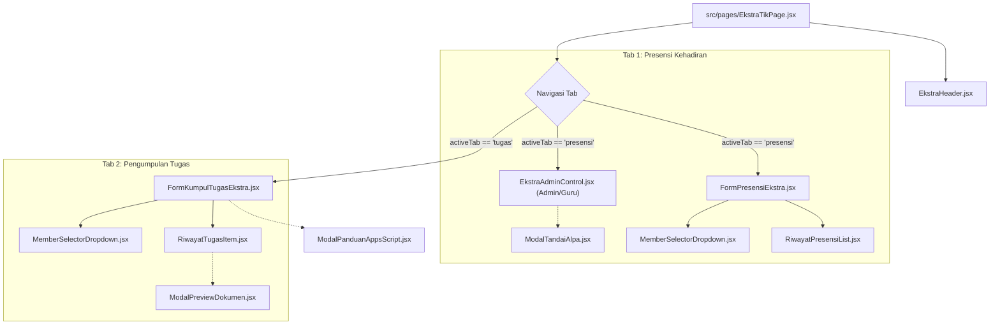

# Dokumentasi Arsitektur & Komponen: Ekstrakurikuler TIK (`src/components/EkstraTik`)

Dokumen ini menyajikan referensi komprehensif seluruh komponen React yang berada di dalam direktori `src/components/EkstraTik/` pada platform **Ruang Spendaraja (SMP Negeri 2 Singaraja)**. Modul ini melayani operasional presensi digital mingguan (setiap hari Jumat) dan pengumpulan tugas proyek teknologi bagi 42 anggota terpilih.

---

## 1. Peta File & Struktur Direktori

```text
src/components/EkstraTik/
├── EkstraHeader.jsx              # Banner portal, status absensi live & kartu profil pengguna
├── EkstraAdminControl.jsx        # Panel saklar kontrol sesi absen, ekspor CSV presensi & trigger alpa
├── FormPresensiEkstra.jsx        # Formulir pencatatan presensi siswa (Hadir) & guru (Izin/Sakit)
├── MemberSelectorDropdown.jsx    # Dropdown pencarian instan 42 anggota resmi Ekstra TIK
├── ModalTandaiAlpa.jsx           # Modal konfirmasi & eksekusi penandaan Alpa siswa belum absen
├── RiwayatPresensiList.jsx       # Log riwayat kehadiran gaya WhatsApp 1 kolom terbungkus per hari
├── FormKumpulTugasEkstra.jsx     # Formulir unggah tugas ke Cloudinary & panel rekap tugas
├── RiwayatTugasItem.jsx          # Kartu pengumpulan tugas dengan proteksi unduh milik sendiri
├── ModalPreviewDokumen.jsx       # Modal pratinjau dokumen multi-engine (Office Online & Google Docs)
└── ModalPanduanAppsScript.jsx    # Modal panduan & template kode integrasi Google Apps Script
```

---

## 2. Diagram Arsitektur & Alur Data



---

## 3. Matriks Hak Akses Pengguna (Role-Based Access Control / RBAC)

Modul ini mengimplementasikan pemisahan hak akses ketat antara **Siswa** dan **Guru / Admin**:

| Fitur / Aksi | Siswa Terdaftar (42 Anggota) | Siswa Luar Anggota | Guru / Admin |
|---|:---:|:---:|:---:|
| **Melihat Beranda & Log Presensi** | ✅ Ya | ✅ Ya (Read-only) | ✅ Ya |
| **Mengisi Presensi Mandiri** | ✅ Ya (Hanya "Hadir", hari H) | ❌ Ditolak | ✅ Ya (Semua status) |
| **Mencatat Status Izin / Sakit** | ❌ Dilarang | ❌ Dilarang | ✅ Ya (Khusus Guru/Admin) |
| **Buka / Tutup Sesi Absensi** | ❌ Dilarang | ❌ Dilarang | ✅ Ya (`game_controls`) |
| **Tandai Alpa Massal** | ❌ Dilarang | ❌ Dilarang | ✅ Ya (`ModalTandaiAlpa`) |
| **Unduh Rekap Presensi (.CSV)** | ❌ Dilarang | ❌ Dilarang | ✅ Ya |
| **Mengumpulkan Tugas Sendiri** | ✅ Ya (Cloudinary `tugas_ekstra_tik7`) | ❌ Ditolak | ✅ Ya |
| **Pratinjau Tugas Siswa Lain** | ✅ Ya (`ModalPreviewDokumen`) | ✅ Ya | ✅ Ya |
| **Unduh Berkas Tugas Siswa Lain** | ❌ **Dilarang (Tombol Disembunyikan)** | ❌ **Dilarang** | ✅ Ya (Untuk Penilaian) |
| **Unduh Berkas Tugas Milik Sendiri** | ✅ **Diizinkan** | - | ✅ Ya |
| **Unduh Rekap Tugas (.CSV)** | ❌ **Dilarang (Tombol Disembunyikan)** | ❌ **Dilarang** | ✅ **Diizinkan** |

---

## 4. Dokumentasi Rinci Masing-Masing Komponen

---

### A. `EkstraHeader.jsx`
Komponen banner header visual di bagian paling atas halaman portal `/ekstra-tik`.

* **Tujuan**: Memberikan identitas visual portal, status buka/tutup absensi realtime, dan ringkasan profil akun pengguna yang sedang masuk.
* **Props**:
  * `user` (Object | null): Data sesi akun yang tersimpan di `localStorage` (`user_siswa`).
  * `isLocked` (Boolean): Status terkunci tidaknya sesi absensi dari tabel `game_controls`.
  * `onOpenLogin` (Function): Callback pembuka modal login jika pengunjung belum masuk.
* **Fitur Utama**:
  1. **Badge Status Realtime**: Badge dinamis dengan animasi emerald pulse (*"Absen Dibuka"*) atau badge rose dengan ikon gembok (*"Absen Ditutup"*).
  2. **Profil Card Adaptif**: Menampilkan inisial nama, kelas, nomor absen, serta badge emas/ungu `GURU/ADMIN` jika memiliki privilese khusus.

---

### B. `EkstraAdminControl.jsx`
Panel manajemen khusus yang hanya dirender jika pengguna berstatus Guru atau Admin (`user.role === 'admin' || user.role === 'guru' || user.role_2 === 'admin'`).

* **Tujuan**: Pengendalian sesi absensi, ekspor rekapitulasi nilai presensi ke format `.CSV`, dan verifikasi alpa siswa.
* **Props**:
  * `isLocked` (Boolean): Nilai state saklar kunci absensi saat ini.
  * `setIsLocked` (Function): Setter state kunci absensi.
  * `anggotaList` (Array): Daftar 42 anggota resmi dari tabel `ekstra_anggota`.
  * `presensiList` (Array): Seluruh data presensi dari tabel `ekstra_presensi`.
  * `onRefreshData` (Function): Callback pemicu pembaruan data Supabase.
* **Fitur Utama**:
  1. **Smart Close-Session Safeguard**: Saat admin menekan tombol "Tutup Sesi Absen", sistem memeriksa apakah masih ada anggota yang belum absen pada hari ini. Jika ada, sistem otomatis membuka `ModalTandaiAlpa.jsx` agar admin dapat memutuskan apakah siswa tersebut ditandai Alpa terlebih dahulu sebelum sesi dikunci.
  2. **Ekspor CSV Matriks Presensi (`handleDownloadCsv`)**: Menggunakan `generatePresensiCsv()` untuk menyusun matriks kehadiran seluruh 42 siswa di semua tanggal pertemuan ke file `.csv` yang kompatibel dengan Microsoft Excel.

---

### C. `FormPresensiEkstra.jsx`
Formulir utama pencatatan presensi kehadiran mingguan.

* **Tujuan**: Menangani input kehadiran siswa di Lab Komputer dan logging presensi ke Supabase.
* **Props**:
  * `user` (Object | null): Pengguna yang sedang login.
  * `isLocked` (Boolean): Status saklar sesi absensi.
  * `anggotaList` (Array): Daftar 42 anggota resmi.
  * `allPresensiList` (Array): Data presensi lengkap untuk diteruskan ke log riwayat.
  * `onRefreshData` (Function): Callback refresh data.
  * `onOpenLogin` (Function): Callback modal login.
* **Logika Bisnis & Proteksi**:
  1. **Deteksi Otomatis Akun Siswa**: Siswa yang login otomatis dipetakan ke data 42 anggota (`registeredMember`). Kolom Nama, Kelas, dan NISN terkunci (*read-only*) sehingga siswa tidak bisa memalsukan identitas teman.
  2. **Pembatasan Opsi Siswa**: Siswa hanya dapat memilih opsi **"Hadir"**. Opsi **"Izin"** dan **"Sakit"** (beserta input keterangan alasan) hanya dapat dipilih oleh Guru/Admin.
  3. **Proteksi Tanggal Pertemuan**: Siswa hanya bisa presensi untuk tanggal hari ini (`todayIso`), sedangkan Guru/Admin dapat memilih tanggal lampau untuk keperluan koreksi data.

---

### D. `MemberSelectorDropdown.jsx`
Komponen dropdown pemilih anggota dengan fitur pencarian instan (*autocomplete search*).

* **Tujuan**: Memudahkan guru/admin memilih siswa dari 42 anggota tanpa perlu mengetik NISN/Nama manual.
* **Props**:
  * `anggotaList` (Array): Koleksi anggota ekstra.
  * `onSelectMember` (Function): Handler saat salah satu siswa dipilih.
* **Fitur Utama**:
  * Input pencarian real-time yang memfilter nama, kelas, atau nomor absen secara responsif.
  * Menampilkan nomor urut seleksi (`#1` s.d `#42`), nama lengkap, kelas, dan nomor absen.

---

### E. `ModalTandaiAlpa.jsx`
Dialog modal konfirmasi untuk menandai siswa yang belum hadir sebagai "Alpa" secara massal.

* **Tujuan**: Mencegah kekosongan data rekapitulasi presensi pada akhir sesi ekstrakurikuler.
* **Props**:
  * `isOpen` (Boolean): Kontrol visibilitas modal.
  * `onClose` (Function): Handler penutup modal.
  * `tanggalAwal` (String): Tanggal default (YYYY-MM-DD).
  * `anggotaList` (Array): Data 42 anggota.
  * `presensiList` (Array): Seluruh baris presensi Supabase.
  * `isCloseSessionFlow` (Boolean): Menandakan apakah modal dibuka dari alur penutupan sesi.
  * `onSuccess` (Function): Callback saat operasi selesai.
  * `onCloseSessionOnly` (Function): Opsi admin hanya menutup sesi tanpa mengubah status alpa.
* **Fitur Utama**:
  * Menghitung secara dinamis daftar siswa yang *sudah absen* vs *belum absen*.
  * Menampilkan pratinjau daftar nama siswa yang akan diberi status "Alpa".
  * Mengeksekusi upsert massal ke tabel `ekstra_presensi` melalui service `tandaiAlpaSiswaBelumAbsen`.

---

### F. `RiwayatPresensiList.jsx`
Komponen penyajian log riwayat kehadiran bergaya pesan WhatsApp.

* **Tujuan**: Memberikan transparansi catatan kehadiran seluruh anggota secara kronologis tanpa tab terpisah.
* **Props**:
  * `allPresensiList` (Array): Kumpulan riwayat presensi dari Supabase.
  * `anggotaList` (Array): Daftar anggota resmi.
* **Fitur Utama**:
  1. **Pengelompokan Harian (WhatsApp Style)**: Catatan presensi dikelompokkan per tanggal pertemuan dengan sticky header tanggal bahasa Indonesia (contoh: *Jumat, 13 November 2026*).
  2. **Filter & Pencarian**: Filter tanggal pertemuan unik, filter status kehadiran (Hadir, Izin, Sakit, Alpa), dan input pencarian nama/kelas.
  3. **Statistik KPI Kehadiran**: Widget ringkasan jumlah Hadir (hijau), Izin (kuning), Sakit (ungu), dan Alpa (merah).

---

### G. `FormKumpulTugasEkstra.jsx`
Formulir pengumpulan proyek digital dan pusat pemantauan tugas ekstrakurikuler.

* **Tujuan**: Menerima berkas tugas siswa, mengunggah ke Cloudinary, mencatat metadata ke Supabase, dan menyediakan galeri pengumpulan.
* **Props**:
  * `user` (Object | null): Sesi akun pengguna.
  * `anggotaList` (Array): 42 anggota resmi.
  * `onOpenLogin` (Function): Handler pemicu modal login.
* **Fitur Utama**:
  1. **Drag-and-Drop & File Validation**: Mendukung unggahan berkas Word (`.docx`), PDF, Scratch (`.sb3`), gambar, dan arsip zip hingga 25 MB langsung ke Cloudinary preset **`tugas_ekstra_tik7`**.
  2. **Scope Switcher**: Tab **"Semua Siswa"** (menampilkan seluruh penugasan 42 anggota) dan **"Siswa Terpilih"** (khusus siswa aktif).
  3. **Proteksi Unduh Rekap CSV**: Tombol unduh rekap berkas tugas (.CSV) dibungkus proteksi `{isAdmin && ( ... )}` dan guard clause `if (!isAdmin) return;` sehingga **khusus hanya bisa diakses oleh akun Guru atau Admin**.
  4. **Penyajian Daftar Terpusat**: Merender setiap baris penugasan menggunakan komponen terpisah `RiwayatTugasItem.jsx`.

---

### H. `RiwayatTugasItem.jsx`
Komponen kartu untuk setiap item pengumpulan tugas siswa dalam daftar riwayat.

* **Tujuan**: Menampilkan identitas pengumpul, judul tugas, nama berkas, catatan, waktu kirim, serta tombol aksi pratinjau dan unduh.
* **Props**:
  * `item` (Object): Objek tugas dari tabel `ekstra_tugas_pengumpulan`.
  * `user` (Object | null): Pengguna yang sedang aktif.
  * `activeSiswaId` (Number | String): ID siswa aktif.
  * `activeNama` (String): Nama siswa aktif.
  * `activeKelas` (String): Kelas siswa aktif.
  * `isAdmin` (Boolean): Menandakan apakah pengguna adalah admin/guru.
  * `isOwner` (Boolean, optional): Override eksplisit kepemilikan.
  * `onPreview` (Function): Callback pembuka `ModalPreviewDokumen`.
* **Proteksi Kepemilikan Unduh (`canDownload`)**:
  ```javascript
  // Evaluasi kepemilikan berkas tugas
  const isSelf = typeof isOwner !== 'undefined'
    ? Boolean(isOwner)
    : Boolean(
        (activeSiswaId && (item.siswa_id || item.siswaId) && String(activeSiswaId) === String(item.siswa_id || item.siswaId)) ||
        (user?.id && (item.siswa_id || item.siswaId) && String(user.id) === String(item.siswa_id || item.siswaId)) ||
        ((user?.NISN || user?.nisn) && (item.nisn || item.master_siswa?.NISN) && String(user?.NISN || user?.nisn).trim() === String(item.nisn || item.master_siswa?.NISN).trim()) ||
        (activeNama && item.nama && activeNama.trim().toLowerCase() === item.nama.trim().toLowerCase()) ||
        (user?.NAMA && item.nama && user.NAMA.trim().toLowerCase() === item.nama.trim().toLowerCase())
      );

  const canDownload = isSelf || Boolean(isAdmin);
  ```
  * **Jika berkas adalah milik siswa itu sendiri**: Tombol Unduh (`<Download />`) **tetap ditampilkan**.
  * **Jika berkas milik siswa lain**: Tombol Unduh **disembunyikan** (mencegah siswa saling menjiplak berkas teman).
  * **Jika akun Guru/Admin**: Tombol Unduh **selalu tersedia** untuk memeriksa berkas siswa.

---

### I. `ModalPreviewDokumen.jsx`
Modal pop-up penampil berkas multifungsi berbasis Portal (`document.body`).

* **Tujuan**: Membuka dokumen langsung di browser tanpa memaksa unduh file terlebih dahulu.
* **Props**:
  * `isOpen` (Boolean): Kontrol buka/tutup modal.
  * `onClose` (Function): Handler penutup.
  * `fileData` (Object): Metadata berkas (`fileUrl`, `fileName`, `judulTugas`, `nama`, `kelas`, `canDownload`).
* **Fitur Utama**:
  1. **Multi-Engine Office Online**: Berkas Microsoft Office (`.docx`, `.xlsx`, `.pptx`) dibuka menggunakan *Microsoft Office Online Live Viewer* (`https://view.officeapps.live.com/op/embed.aspx?src=...`) dengan opsi saklar cepat ke *Google Docs Viewer*.
  2. **Proteksi Unduh Modal**: Tombol "Unduh" di header modal diproteksi dengan kondisi `{fileData?.canDownload !== false && ( ... )}` sehingga siswa yang sedang melihat pratinjau tugas teman tetap tidak dapat mengunduh berkas tersebut dari dalam modal.
  3. **Deteksi Loading Lambat**: Menampilkan timeout peringatan jika iframe viewer membutuhkan waktu lebih dari 5 detik untuk memuat.

---

### J. `ModalPanduanAppsScript.jsx`
Modal referensi teknis yang memuat panduan deployment dan kode sumber Google Apps Script (`Code.gs`).

* **Tujuan**: Dokumentasi cadangan bagi pembina ekstrakurikuler jika ingin menyinkronkan data tugas ke Google Drive bersama atau Google Spreadsheet sekolah.
* **Props**:
  * `isOpen` (Boolean): Status tampilan modal.
  * `onClose` (Function): Handler penutup modal.
* **Fitur Utama**:
  * Tombol 1-klik salin seluruh template kode `Code.gs`.
  * Langkah demi langkah pengaturan hak akses Google Web App (`Execute as: Me`, `Access: Anyone`).

---

## 5. Layanan Pendukung (`src/services/ekstraTikService.js`)

Seluruh komponen di atas berinteraksi dengan Supabase Database dan Cloudinary melalui fungsi-fungsi tersentralisasi berikut:

| Nama Fungsi | Deskripsi & Operasi Database |
|---|---|
| `getStatusAbsenEkstra()` | Membaca status `is_locked` dari `game_controls` (`game_id = 'ekstra_tik_absen'`). |
| `setStatusAbsenEkstra(isLocked)` | Memperbarui kolom `is_locked` pada tabel `game_controls`. |
| `subscribeStatusAbsenEkstra(cb)` | Berlangganan perubahan realtime status sesi absensi via Supabase WebSocket. |
| `getAnggotaEkstra()` | Mengambil 42 anggota resmi dari `ekstra_anggota` yang direlasikan ke `master_siswa`. |
| `getPresensiEkstra()` | Mengambil seluruh baris absensi dari `ekstra_presensi` beserta data profil siswa. |
| `subscribePresensiEkstra(cb)` | Berlangganan event `INSERT`/`UPDATE` tabel `ekstra_presensi` secara realtime. |
| `kirimPresensiEkstraSupabase(payload)` | Melakukan `upsert` kehadiran harian siswa dengan proteksi konflik unik `(tanggal, siswa_id)`. |
| `tandaiAlpaSiswaBelumAbsen({ tanggal, anggotaList })` | Melakukan batch `upsert` status "Alpa" untuk anggota yang belum terdata pada tanggal pertemuan. |
| `getMasterTugasEkstra()` | Mengambil daftar tugas dari tabel `ekstra_tugas_master`. |
| `getTugasPengumpulanEkstra(...)` | Mengambil berkas tugas siswa dari `ekstra_tugas_pengumpulan`. |
| `kumpulTugasEkstraSupabase(payload)` | Menyimpan tautan berkas Cloudinary dan catatan tugas siswa dengan konflik `(id_tugas, siswa_id)`. |
| `generatePresensiCsv(anggota, presensi)` | Menyusun teks CSV matriks rekap kehadiran seluruh pertemuan. |
| `generateTugasCsv(tugasList)` | Menyusun teks CSV rekap pengumpulan berkas tugas siswa. |
| `downloadCsvFile(csvContent, filename)` | Men-trigger download otomatis file `.csv` di browser pengguna. |
| `formatFileSize(bytes)` | Memformat ukuran berkas numerik menjadi format yang ramah (KB / MB). |

---

## 6. Ringkasan Praktik Terbaik Pengembangan

1. **Prinsip Single Source of Truth**: Data profil siswa (nama, kelas, absen, gender, NISN) selalu berakar pada tabel `master_siswa` yang terhubung melalui Foreign Key `siswa_id`.
2. **Keamanan Berkas Siswa**: Tautan unduh tugas siswa lain sengaja ditiadakan untuk menjaga integritas orisinalitas tugas di kalangan siswa, namun tetap terbuka untuk guru dan admin untuk keperluan evaluasi.
3. **Pemisahan Tanggung Jawab Komponen**: Setiap komponen UI memiliki batasan tanggung jawab yang jelas (*Single Responsibility Principle*), seperti `RiwayatTugasItem.jsx` yang mengelola rendering kartu tugas dan validasi kepemilikan secara mandiri.
