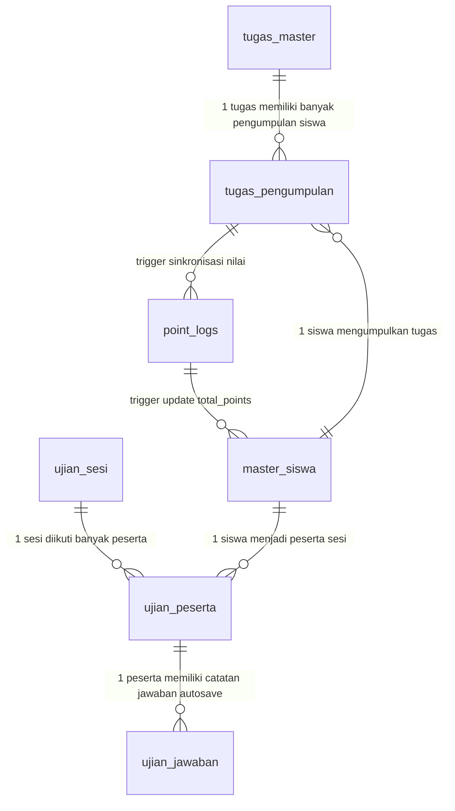

# Dokumentasi Arsitektur & Perancangan Tugas 7: Ulangan Informatika (Persiapan Tes Sumatif Ganjil)

Dokumen ini adalah spesifikasi teknis dan panduan arsitektur perancangan **Tugas ke-7: Ulangan Informatika (Persiapan Tes Sumatif Ganjil - Paket Latihan Paralel Set B)** di platform **Ruang Spendaraja**.

---

## 1. Ringkasan & Tujuan Modul

Modul Tugas 7 dirancang sebagai simulasi Computer-Based Test (CBT) modern terintegrasi untuk siswa kelas 7 SMP Negeri 2 Singaraja. Modul ini menggantikan komponen legacy `src/components/Ulangan` dan dipindahkan ke arsitektur modul praktikum mandiri di folder:
```text
src/components/RuangBelajar/TugasKhusus/Tugas7/
```

### Karakteristik Utama Modul:
1. **Bank Soal & Asisten Materi**: Memuat 50 butir Pilihan Ganda (PG) dan 5 butir Esai/Uraian lengkap dengan kunci jawaban, pembahasan, dan panel asisten materi pendamping (*scaffolding hint*) yang memberikan konsep belajar tanpa membocorkan langsung huruf/angka jawaban.
2. **Keamanan & Anti-Cheat Berlapis**: Deteksi pindah tab (*blur / visibility change*) dan keluar fullscreen dengan batas maksimal 3 kali pelanggaran. Fullscreen otomatis saat mulai, dialog jeda (*pause dialog*) saat melanggar, dan auto-lock jika mencapai toleransi maksimal.
3. **Sinkronisasi Realtime & Ruang Tunggu (Waiting Room)**: Masuk menggunakan token/PIN sesi ujian, ruang tunggu peserta live, dan penghitung mundur (*countdown*) serentak yang dipicu oleh Guru/Admin.
4. **Kontrol Panel Guru / Admin**: Tombol pintas beralih ke Admin Panel khusus `role === 'admin'`, pemantauan live pelanggaran kecurangan siswa, kontrol aktivasi sesi, token generator, dan penyelesaian ujian paksa.
5. **Penyajian 1 Soal Per Layar**: Dilengkapi kisi kotak navigasi nomor 1–50 dengan indikator warna status jawaban (Hijau = sudah dijawab, Abu-abu = belum dijawab, Biru ring = aktif).
6. **Pengacakan Ganda (Double Shuffle)**: Urutan nomor soal dan posisi pilihan jawaban (A, B, C, D) diacak untuk setiap siswa menggunakan algoritma *Fisher-Yates*, sehingga setiap siswa memperoleh susunan yang unik.
7. **Kepatuhan Standar Schema v2.0**: Riwayat dan rincian pengerjaan disimpan ke tabel `tugas_pengumpulan` pada kolom `detail_jawaban` dengan schema v2.0 yang otomatis memicu kalkulasi poin ke `master_siswa.total_points`.

---

## 2. Analisis & Kebutuhan Tabel Database Supabase

Untuk menjalankan alur ujian realtime sekaligus mencatat rekap nilai resmi, sistem menggunakan perpaduan **5 tabel terkoordinasi**:



### A. Tabel `tugas_master` (Pusat Definisi Modul)
Menyimpan baris metadata untuk Tugas 7 di Ruang Belajar:
* `id`: UUID (Dihasilkan otomatis atau didefinisikan secara unik).
* `kode_tugas`: `'TUGAS-07-ULANGAN-INFORMATIKA'`
* `urutan`: `7`
* `judul`: `'Tugas 7: Ulangan Informatika (Persiapan Tes Sumatif Ganjil)'`
* `deskripsi`: `'Ujian sumatif Informatika 50 butir soal pilihan ganda dengan pengawasan anti-cheat dan asisten materi pendamping.'`
* `kategori`: `'Ulangan & Evaluasi'`
* `tipe_tugas`: `'kuis_murni'`
* `custom_route`: `'/tugas/ulangan-informatika'`
* `poin_maksimal`: `100`
* `bobot_nilai`: `1.0`
* `is_active`: `true`

### B. Tabel `tugas_pengumpulan` (Single Source of Truth Rekap Nilai Siswa)
Tempat penyimpanan nilai akhir siswa yang terikat dengan trigger audit nilai:
* `id`: UUID (Primary Key, default `gen_random_uuid()`)
* `tugas_id`: UUID (Foreign Key ke `tugas_master.id`)
* `siswa_id`: Integer (Foreign Key ke `master_siswa.id`)
* `status`: Text (`'belum'` | `'dinilai'`)
* `skor`: Integer (`0` s.d. `100`, dihitung dari `(benar / total_soal) * 100`)
* `persentase_skor`: Numeric(5, 2)
* `detail_jawaban`: JSONB (Mengikuti **Standar Schema v2.0**, spesifikasi di bawah)
* `submitted_at`: Timestamp with time zone
* **Database Triggers**:
  - `trg_sync_tugas_to_point_logs` → membuat baris di `point_logs`
  - `trg_update_master_siswa_total_points` → mengupdate `master_siswa.total_points`

### C. Tabel `ujian_sesi` (Orkestrasi Realtime Sesi Ujian)
Mengontrol jalannya sesi ujian bersama di kelas/lab:
* `id`: UUID (Primary Key, default `gen_random_uuid()`)
* `judul`: Text (Contoh: `'Ulangan Harian 7 - Kelas 7A'`)
* `pin_ujian`: Text (Token/PIN masuk 5 karakter acak unik, misal: `'7CUEO'`)
* `status`: Text (`'waiting'` | `'starting'` | `'ongoing'` | `'finished'`)
* `durasi_menit`: Integer (Default 90 menit)
* `created_at`: Timestamp with time zone

### D. Tabel `ujian_peserta` (Telemetri Realtime & Anti-Cheat)
Memantau keaktifan peserta saat sesi berlangsung secara langsung:
* `id`: Serial / Integer (Primary Key)
* `sesi_id`: UUID (Foreign Key ke `ujian_sesi.id`)
* `siswa_id`: Integer (Foreign Key ke `master_siswa.id`)
* `cheat_count`: Integer (Default 0, bertambah saat keluar tab/fullscreen)
* `status_ujian`: Text (`'ready'` | `'ongoing'` | `'submitted'` | `'blocked'`)
* `nilai_akhir`: Numeric / Integer (Skor live ujian)
* `joined_at`: Timestamp with time zone

### E. Tabel `ujian_jawaban` (Realtime Autosave Cadangan Per Butir Soal)
Menjamin jawaban siswa tidak hilang saat internet terputus di tengah jalan:
* `id`: Serial / Integer (Primary Key)
* `peserta_id`: Integer (Foreign Key ke `ujian_peserta.id`)
* `jawaban_map`: JSONB (Key-value: `{ [soal_id]: string_opsi_dipilih }`)
* `updated_at`: Timestamp with time zone

---

## 3. Spesifikasi Format `detail_jawaban` (Schema v2.0)

Sesuai aturan `docs/tugas/STANDARISASI_FORMAT_DETAIL_JAWABAN.md`, payload `detail_jawaban` pada Tugas 7 disusun menggunakan struktur standar v2.0:

```json
{
  "schema_version": "2.0",
  "tipe_tugas": "kuis_murni",
  "meta": {
    "kode_tugas": "TUGAS-07-ULANGAN-INFORMATIKA",
    "judul_tugas": "Tugas 7: Ulangan Informatika (Persiapan Tes Sumatif Ganjil)",
    "active_stage": 1,
    "total_stages": 1,
    "time_spent_seconds": 3240,
    "attempt_count": 1,
    "last_saved_at": "2026-11-16T12:00:00.000Z",
    "is_completed": true,
    "cheat_count": 0
  },
  "ringkasan_skor": {
    "skor_maksimal": 100,
    "skor_diperoleh": 88,
    "skor_tertinggi_disimpan": 88,
    "breakdown": [
      {
        "id": "pilihan_ganda",
        "label": "Soal Pilihan Ganda (50 Butir)",
        "skor": 88,
        "skor_maks": 100,
        "status": "lulus"
      }
    ]
  },
  "auto_grading": {
    "passed": true,
    "kriteria_kktp": 75,
    "total_soal": 50,
    "jumlah_benar": 44,
    "jumlah_salah": 6,
    "jumlah_kosong": 0,
    "persentase": 88.0
  },
  "custom_state": {
    "sesi_id": "cdfc1046-9d4a-4f16-b5e0-788d79aac020",
    "pin_ujian": "TCKEL",
    "shuffled_soal_order": ["PG_14", "PG_02", "PG_28", "..."],
    "jawaban_siswa": {
      "PG_01": "Abstraksi",
      "PG_02": "Maju 1 langkah → Putar 90° kanan → Maju 2 langkah → Putar 90° kiri → Maju 2 langkah"
    },
    "cheat_logs": [
      {
        "timestamp": "2026-11-16T11:42:15.120Z",
        "reason": "Keluar dari mode fullscreen",
        "count": 1
      }
    ]
  }
}
```

---

## 4. Mekanisme Keamanan & Anti-Cheat (Proctoring)

### A. Alur Deteksi Pelanggaran (Maksimal 3x)
1. **Pemicu Deteksi**:
   - Event `document.onfullscreenchange`: Mendeteksi siswa menekan tombol ESC, F11, atau keluar dari jendela penuh.
   - Event `document.onvisibilitychange` (`document.hidden`): Mendeteksi siswa membuka tab baru, beralih ke aplikasi WhatsApp/browser lain.
   - Event `window.onblur`: Mendeteksi kursor keluar dari jendela browser ujian.
2. **Penanganan Pelanggaran ke-1 & ke-2**:
   - Layar ujian langsung di-*pause* dan ditutupi oleh **Modal Peringatan Keamanan Merah (*Pause Dialog*)**.
   - Bunyi audio peringatan *beep* berfrekuensi tinggi.
   - Timer pengerjaan tetap berjalan, tetapi soal dan tombol opsi terkunci (tidak bisa diklik).
   - Teks peringatan: *"Peringatan Kecurangan ke-[X]/3! Anda dilarang membuka tab lain atau keluar dari layar penuh."*
   - Tombol: *"Kembali & Lanjutkan Fullscreen"*. Siswa wajib mengklik tombol ini agar layar kembali fullscreen dan soal terbuka kembali.
   - Angka `cheat_count` langsung di-sync ke tabel `ujian_peserta` di Supabase secara realtime.
3. **Penanganan Pelanggaran ke-3 (Diskualifikasi / Auto-Lock)**:
   - Status peserta berubah menjadi `'blocked'`.
   - Seluruh jawaban yang sudah tersimpan otomatis di-*submit* ke server.
   - Layar terkunci secara permanen dengan notifikasi: *"Ujian Terkunci Karena Pelanggaran 3x. Silakan hubungi Guru Pengawas untuk membuka akses kembali."*
   - Pada Admin Panel Guru, siswa tersebut ditandai dengan badge merah menyala `BLOCKED (3 Pelanggaran)` disertai tombol 1-klik untuk *"Reset Pelanggaran & Izinkan Ujian Kembali"*.

---

## 5. Tata Letak Antarmuka Siswa (Split Screen Dual-Pane)

Antarmuka ujian dirancang responsif, bersih, dan fokus:

```text
+-----------------------------------------------------------------------------------------+
| [SMPN 2 SINGARAJA]  Tugas 7: Ulangan Informatika        [Timer: 01:24:12]  [Pelanggaran: 0/3] |
+-------------------------------------------------------------+---------------------------+
|                      PANE KIRI (SOAL CBT)                   |   PANE KANAN (ASISTEN)    |
|                                                             |                           |
|  [Soal No. 2 dari 50]              [Status: Sudah Dijawab]   |  💡 ASISTEN MATERI        |
|                                                             |  Topik: Navigasi Arah     |
|  Perhatikan gambar papan permainan Robot Manual 5x5...      |  Robot pada Grid          |
|  +-------------------------------------------------------+  |                           |
|  | [ Gambar Diagram SVG Soal 2: Papan Robot Manual 5x5 ] |  |  "Perintah Maju N         |
|  +-------------------------------------------------------+  |  langkah memindahkan      |
|                                                             |  karakter searah mata     |
|  ( ) A. Maju 2 langkah → Putar 90° kanan...                 |  panah hadapnya saat ini. |
|  (*) B. Maju 1 langkah → Putar 90° kanan...                 |  Perintah Putar 90°       |
|  ( ) C. Maju 1 langkah → Putar 90° kiri...                  |  kanan memutar arah 90    |
|  ( ) D. Putar 90° kanan → Maju 2 langkah...                 |  derajat searah jarum     |
|                                                             |  jam..."                  |
|  ---------------------------------------------------------  |                           |
|  [ ← Sebelumnya ]       [ 🚩 Ragu-ragu ]     [ Selanjutnya → ] |  (Memberikan konsep       |
|                                                             |   tanpa membocorkan       |
|  KISI NAVIGASI NOMOR SOAL:                                  |   jawaban langsung)       |
|  [ 1 ][ 2 ][ 3 ][ 4 ][ 5 ][ 6 ][ 7 ][ 8 ][ 9 ][ 10 ]        |                           |
|  [11 ][12 ][13 ][14 ][15 ][16 ][17 ][18 ][19 ][ 20 ]        |                           |
|  ... (Kotak Hijau = Terjawab, Kotak Abu = Belum)            |                           |
+-------------------------------------------------------------+---------------------------+
```

### Navigasi Kotak Soal:
* **Warna Hijau (`bg-emerald-600`)**: Soal sudah dipilih jawabannya.
* **Warna Abu-abu Gelap (`bg-slate-800` border `slate-700`)**: Soal belum dijawab.
* **Warna Kuning (`bg-amber-500`)**: Soal ditandai ragu-ragu.
* **Cincin Biru (`ring-2 ring-sky-400 scale-105`)**: Soal yang sedang aktif dibuka di layar.

---

## 6. Inventaris Aset Gambar Diagram Soal

Seluruh gambar diagram teknis soal telah dibuat dalam format vektor SVG resolusi tinggi di folder `src/components/RuangBelajar/TugasKhusus/Tugas7/assets/`:

| Nomor Soal | File Aset SVG | Deskripsi Diagram |
|---|---|---|
| **PG No. 2** | `soal_02_robot_grid.svg` | Papan permainan robot manual 5x5 (Robot di A1 hadap Atas, Jeruk di C2, Batu di A3 dan C1, Finis di C4). |
| **PG No. 14** | `soal_14_arsitektur_komputer.svg` | Diagram blok arsitektur komputer (Bagian [P] Input Device, Pemroses CPU & RAM, Sekunder SSD/HDD, Bagian [Q] Output Device). |
| **PG No. 15** | `soal_15_komponen_hardware.svg` | 4 kartu komponen internal komputer: [1] Power Supply, [2] Kartu Grafis GPU, [3] SSD 2.5" 512GB, [4] Processor CPU. |
| **PG No. 17** | `soal_17_hubungan_komponen.svg` | Diagram hierarki relasi: Hardware ↔ Sistem Operasi ↔ Bagian [Y] Program Siap Pakai (Border Putus-putus) ↔ Brainware/User. |
| **PG No. 18** | `soal_18_ikon_software.svg` | 5 kartu ikon perangkat lunak: [1] MS Excel, [2] Ubuntu Linux, [3] Chrome, [4] Android, [5] Photoshop. |
| **PG No. 21** | `soal_21_alur_ascii_cpu.svg` | Alur konversi: Tombol 'B' Keyboard → ASCII 66 (01000010) → Pemrosesan CPU Biner → Konversi Balik Tampil Huruf 'B' di LCD. |
| **PG No. 27** | `soal_27_hierarki_folder.svg` | Pohon direktori Windows Explorer: `C:\Arsip_Siswa\Semester_1\Administrasi\Daftar_Hadir.xlsx`. |
| **PG No. 29 & 30** | `soal_29_ribbon_word.svg` | Pita ribbon Microsoft Word: Group Font ([1] B, [2] I, [3] U, [4] A) dan Group Paragraph ([5] Left, [6] Center, [7] Right, [8] Justify). |
| **PG No. 36** | `soal_36_compose_email.svg` | Jendela surel Gmail Compose: [P] Kepada, [Q] Cc/Bcc, [R] Subjek, dan [S] Ikon Klip Kertas (Attachment). |

---

## 7. Rencana Migrasi & Penghapusan `src/components/Ulangan`

Untuk menjaga kebersihan repositori dan struktur file yang rapi:
1. Seluruh logika inti (PinInput, WaitingRoom, ExamHeader, QuestionCard, SesiCard, StatistikSiswa) diintegrasikan dan disempurnakan langsung ke dalam folder `src/components/RuangBelajar/TugasKhusus/Tugas7/`.
2. Halaman `src/pages/UlanganPage.jsx` dan `src/pages/AdminUjian.jsx` dialihkan referensi impornya ke `TugasKhusus/Tugas7/`.
3. Folder legacy `src/components/Ulangan` dihapus secara permanen.

